# Robot screen manual

How to use the 7 inch touchscreen on the robot (`nala_panel`): choose a map, set the base station, plan a route,
run a scan (app 3) and read the results; drive the robot (app 1) and make new maps (app 2).

Written for the panel code of 2026-10-29 (commit `72bead9`). The screenshots come from the panel's own UI test
(`src/nala_panel/test/test_ui.py` with `NALA_PANEL_SHOTS=<folder>`), so they show a test room, a *Simulation* chip
and no battery reading. On the robot you see your own maps, *Robot* and the real voltage.

## Contents

- [A normal scan](#a-normal-scan)
- [How the screens connect](#how-the-screens-connect)
- [Map list](#map-list)
- [Map screen](#map-screen)
- [Making a plan](#making-a-plan)
- [Planning screen](#planning-screen)
- [Scan screen](#scan-screen)
- [Pause, STOP and going home](#pause-stop-and-going-home)
- [Contamination found](#contamination-found)
- [Results tab](#results-tab)
- [Drive and Make a map](#drive-and-make-a-map)
- [Settings](#settings)
- [Map colours and symbols](#map-colours-and-symbols)
- [Messages and what to do](#messages-and-what-to-do)
- [Troubleshooting](#troubleshooting)

## A normal scan

1. On the map list, tap the map you want to scan.
2. The first time you use a map: open **New plan**, tap **Set base station**, tap where the robot will stand, then
   tap the direction it faces.
3. Optional: set a different start point, or draw an area so only part of the floor is covered.
4. Tap **Plan**. Wait for *Plan ready*, check that all four checks are ticked, then tap **Keep plan**.
5. Put the robot on the base station, facing the direction you set. It must be within 15 cm and 15 deg of the base
   station pose (`locator.base_tolerance_m` / `base_tolerance_deg` in `config/coverage.yaml`).
6. On the **Plans** tab, choose the plan and tap **Scan**. Wait for *Ready* and the *Localized* chip.
7. Tap **Start**. **The robot only moves after Start.**
8. When the screen says *Scan complete*, tap **Back**. A short report appears, and the scan is saved under **Results**.

## How the screens connect

The panel starts by itself when the Pi boots and always opens on the map list. Every other screen has a **< Maps**
or **Back** button that returns there. The battery icon at the top shows the voltage and the charge in %; it turns
red below 14.4 V.

```
Map list ─┬─ tap a map ──▶ Map screen ─┬─ Plans tab ──── Scan ──▶ Scan screen (app 3)
          │                            ├─ New plan tab ─ Plan ──▶ Planning screen
          │                            └─ Results tab
          ├─ Drive (app 1)
          ├─ Make a map (app 2)
          └─ Settings (contamination threshold)
```

Only one app can run at a time. Drive, Make a map and Scan each start their own programs on the robot. Leaving the
screen with **Back** stops that app.

## Map list

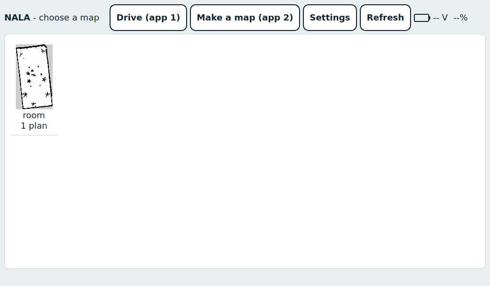

Every folder in `~/NALA/maps/` with a `map.yaml` appears here, with its number of saved plans.

| Button | What it does |
|---|---|
| a map tile | Opens the map screen for that map. |
| **Drive (app 1)** | Drive the robot with the Xbox controller. See [Drive and Make a map](#drive-and-make-a-map). |
| **Make a map (app 2)** | Drive around to build a new map, then save it under a name. |
| **Settings** | The contamination threshold, for every map. |
| **Refresh** | Reads the map folder again. Use it after copying a map or plan onto the robot from a PC. |

## Map screen

The map fills the left side; three tabs are on the right. Pinch with two fingers to zoom, drag with one finger to
move the map, and tap briefly to place a point. The grey line under the map shows hints and errors.

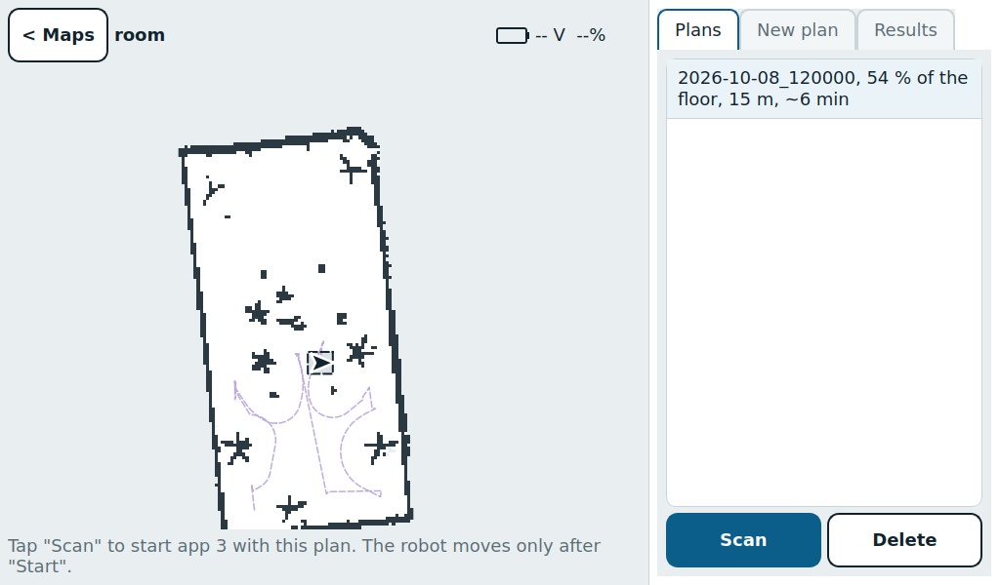

### Plans tab

Saved plans are listed newest first. Each line shows the plan name (its date and time), the share of floor it
covers, the driving length, and the real driving time including the drive home. Plans limited to an area also show
*area*.

- **Scan** starts app 3 with the selected plan and opens the scan screen. Nothing moves yet.
- **Delete** asks first, then removes the plan.
- A **grey** plan with *Cannot scan: ...* would be refused by the robot, and **Scan** stays off. The usual reasons:
  it was made for a different base station, for a different map image, or with different robot or sensor settings.
  Make a new plan.

## Making a plan

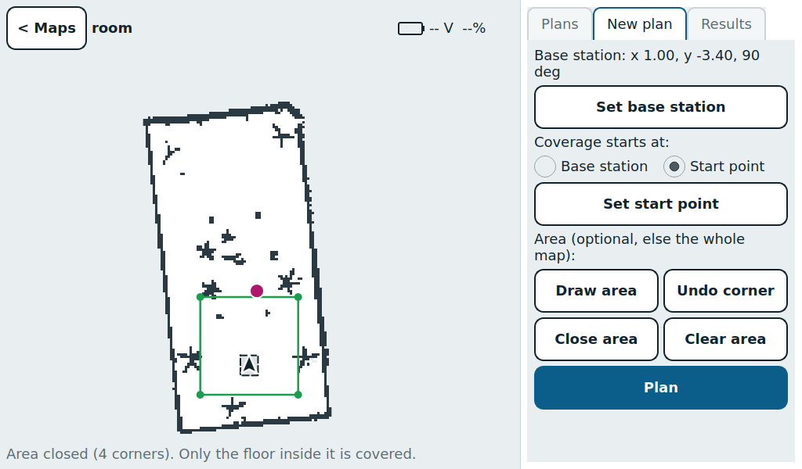

On the map: the base station (dashed robot outline and arrow), the start point (magenta dot) and a closed area
(green).

### Base station

The base station is where the robot starts every scan and to which it returns. It is only a pose on the map: there
is no dock or charger.

1. Tap **Set base station**.
2. Tap where the robot stands. The screen says *Now tap the direction the robot faces on the base station.*
3. Tap a second point in the direction it faces. The base station is saved at once.

A spot too close to a wall for the robot to turn on the spot is refused; try another place.

> **Changing it:** a new base station makes every plan of this map unusable (they turn grey). Make the plans again.

### Where coverage starts

- **Base station** (default): coverage starts where the robot stands.
- **Start point**: tap **Set start point**, then tap the map. The robot still starts on the base station and first
  drives itself to the start point. A point too close to a wall is refused.

### Area (optional)

Without an area, the plan covers all floor the robot can reach. To cover only part of the map:

1. Tap **Draw area**, then tap the corners in order around the area.
2. **Undo corner** removes the last corner.
3. Tap **Close area**. You need at least 3 corners, and the edges must not cross.
4. **Clear area** removes the area again.

Tap each corner once. Two taps on the same spot in a row count as one corner.

### Plan

Tap **Plan**. If something is missing, the hint line says so: *Set the base station first*, *Close the area first,
or clear it*, or *Tap "Set start point" first*.

## Planning screen

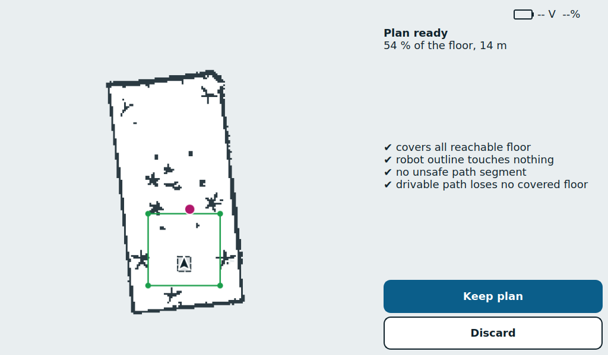

The planner runs on the robot and shows its messages while it works. On a large map this can take several minutes
or much longer. **Cancel** stops it.

When it is done, the screen shows the plan image, the share of floor covered, the length, the driving time and four
checks:

| Check | Meaning |
|---|---|
| covers all reachable floor | Every bit of floor the robot can reach (inside the area, if one is set) is covered. |
| robot outline touches nothing | Along the whole path, the robot's real outline (including the rod in front) stays clear of walls. |
| no unsafe path segment | No part of the path the robot will drive is too close to an obstacle. |
| drivable path loses no covered floor | Rounding the corners for driving leaves no gaps in the coverage. |

The "% of the floor" counts the whole map, so a plan limited to an area shows less than 100 %. That is expected.

- **Keep plan** saves the plan to the Plans tab. It only appears when all four checks pass (*Plan ready*).
- **Discard** deletes it. After *Plan has problems* or *Planning failed*, discard it and change the start point or
  the area.

## Scan screen

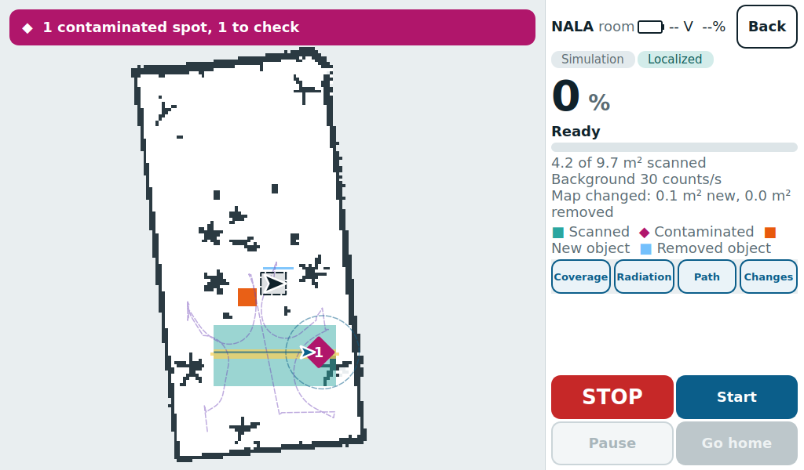

Ready to start: the *Localized* chip is on and **Start** is active.

### Before Start

After **Scan**, the status line goes through these stages:

1. *Starting app 3...*
2. *Finding the robot on the map*: the robot uses the LiDAR to find where it stands, anywhere on the map, and draws
   itself there.
3. If it is not on the base station, one of these messages appears. Move the robot by hand until it goes away:
   - *Robot is not on the base station. Put it on the base station.*
   - *Robot is on the base station the wrong way round. Turn it around.*
   - *Robot is on the base station but turned. Turn it about N degrees to the left/right.*

   The map shows the target outline (dashed) with an arrow for the direction the robot must face.
4. *Checking the plan*: the plan is checked against the robot's settings. Up to about 20 s the first time, about
   1 s after that.
5. *Ready*: **Start** is active.

The two chips under the title show *Robot* or *Simulation*, and *Localized* (green) or *Not localized*. **Start**
needs all of these: the plan is checked, the robot is localized and on the base station, and navigation is running.

### While it drives

| Big view | Map view |
|---|---|
| 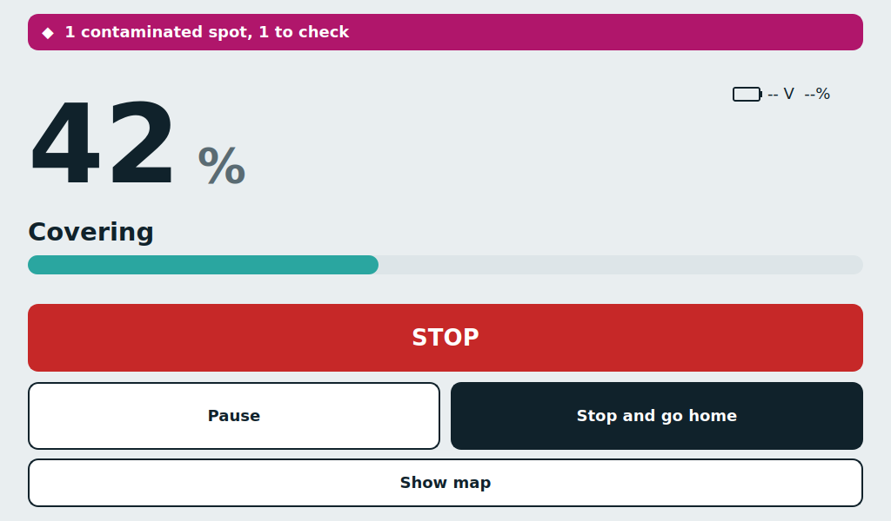 | 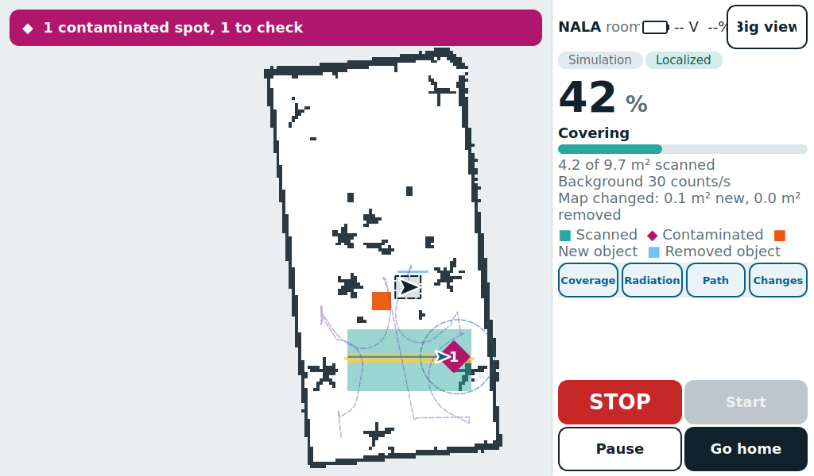 |

Once the robot moves, the screen switches by itself to the big view: the percentage, the current activity, a
progress bar, the hotspot bar and large buttons. After **Show map** the map stays until you tap **Big view** or start
a new scan.

Activities: *Measuring the background* (on the base station, before driving), *Planning the way to the path*,
*Driving to the path*, *Covering*, *Plan done, checking coverage*, *Planning the way back*, *Driving back to the base
station*, then *Scan complete*.

*Recalculating...* means the robot is no longer sure of its position and has paused itself. It continues by itself
once it has found its position again, within about 60 s (`recovery.auto_resume_s`). Nothing to do.

### The side panel

- The scanned area in m², the background in counts/s, and the threshold at which the scan stops.
- *Map changed*: how much floor looks different from the map. **New object** means free floor on the map where the
  LiDAR keeps seeing something (for example a moved cabinet); **removed object** is the opposite. Small errors along
  walls are ignored. If a lot has changed, make a new map.
- The layer buttons **Coverage**, **Radiation**, **Path** and **Changes** show or hide each map layer.

### Hotspots

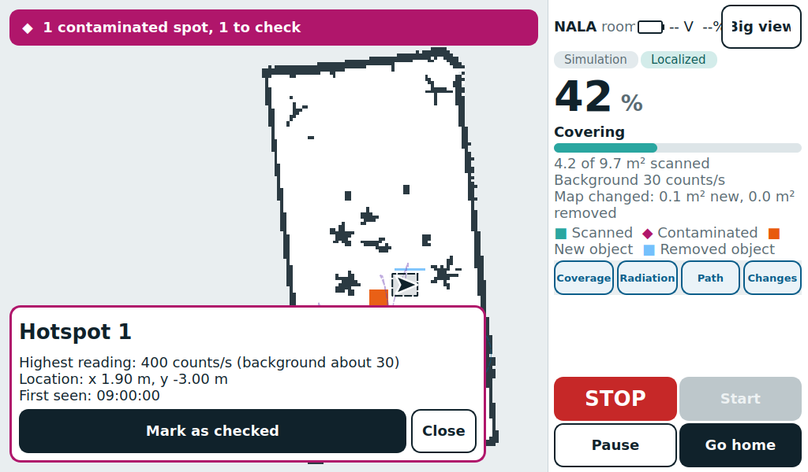

Spots where the readings reached the threshold are numbered magenta diamonds. The bar above the map reads *N
contaminated spots, M to check* and stays magenta until every spot is checked. Tap a spot to see its highest
reading, the background, its position and when it was first seen. Tap **Mark as checked** after someone has looked
at it; the diamond turns white.

## Pause, STOP and going home

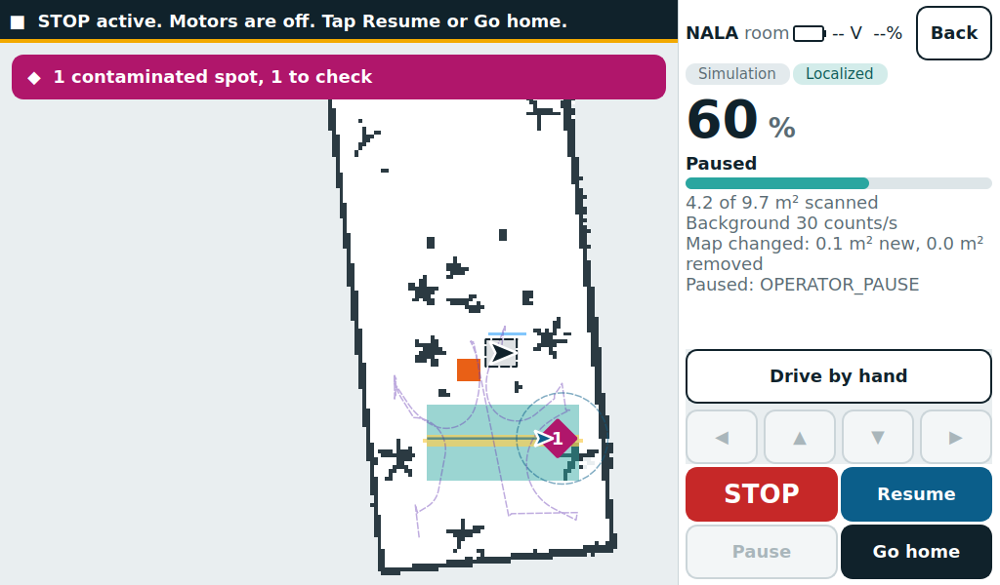

| Control | What happens |
|---|---|
| **STOP** | Always visible. The motors stop at once and the task pauses. A banner says *STOP active. Motors are off. Tap Resume or Go home.* |
| **Pause** | The robot stops and keeps the rest of the plan. The side panel shows *Paused:* and the reason. |
| Xbox **B** | The same as **Pause**, if the controller is on. The controller cannot drive the robot during a scan. |
| **Resume** | Continues the plan where it stopped. It replaces **Start** while paused. |
| **Stop and go home** | Asks *Stop scanning?* first. The robot ends the plan and drives back to the base station. While paused it is called **Go home**. |
| **Back** | Only shown when the robot is not driving. Stops app 3 and shows the scan report. If a task is still paused, it asks whether to cancel it. Use **Go home** first if the robot should return. |

### Driving by hand while paused

1. Tap **Drive by hand**.
2. Hold an arrow button: ▲ forward, ▼ back, ◀ ▶ turn. The robot only moves while you hold it.
3. Tap **Hand control off**, then **Resume**. Resume is not possible while hand control is on.

Hand driving goes through the same velocity gate as the plan. Do not use the keyboard teleop or the Xbox drive mode
during a scan: a second driver stops the robot (`VELOCITY_GRAPH_CONFLICT`).

## Contamination found

| Warning | After Acknowledge |
|---|---|
| 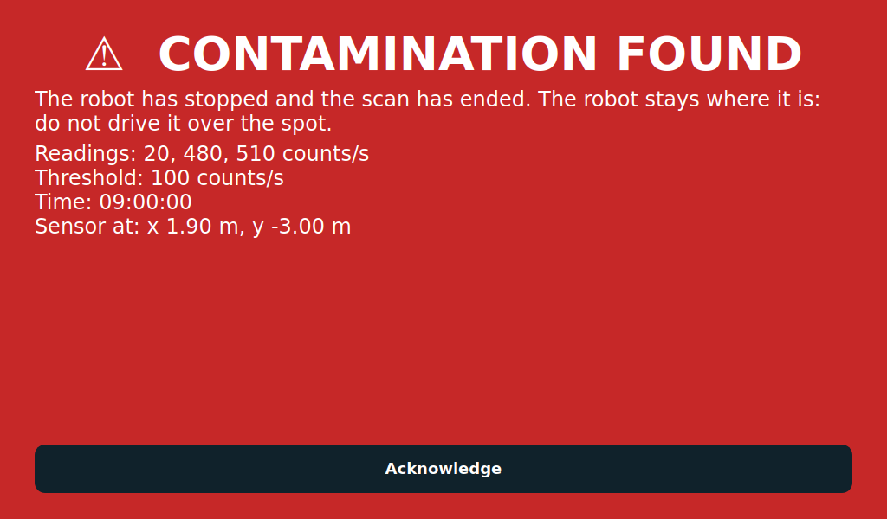 | 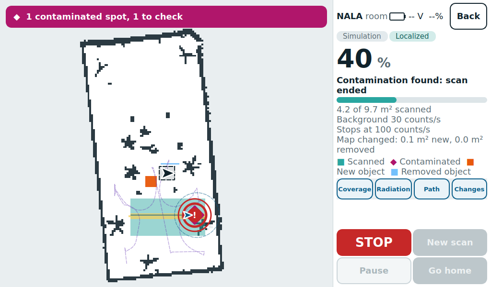 |

When 2 of the last 3 readings reach the threshold, the robot stops at once and the scan ends. This can happen at
any time in a task: driving, paused, during the background measurement, or on the way home. The whole screen turns
red with the readings, the threshold, the time and where the sensor was ("approximate" if the robot was not sure of
its position then), until someone taps **Acknowledge**. Then red rings mark the spot on the map.

> **Important:** after a contamination stop there is no Resume and no Go home. The robot stays where it is. Do not
> drive it over the spot: move it by hand.

> **Current robot setting:** the radiation check is **off** (`radiation.enabled: false` in `config/coverage.yaml`)
> until the real background and threshold are known. Readings are still recorded, but there is no background
> measurement at the start and no contamination stop.

## Results tab

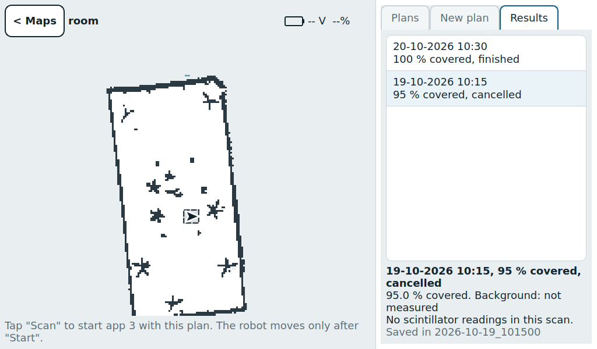

Earlier scans of this map, newest first (drag to scroll). Tap one to draw it on the map: the floor it covered, the
path it drove, the radiation heatmap, its hotspots and map changes. The text under the list gives the coverage, the
background, the contaminated spots and the folder (`maps/<map>/runs/<time>/`).

## Drive and Make a map

| Drive (app 1) | Make a map (app 2) |
|---|---|
| 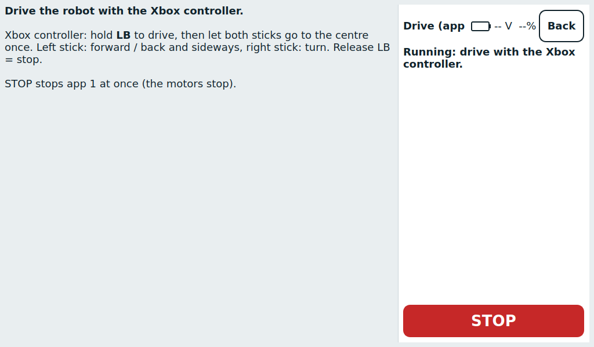 | 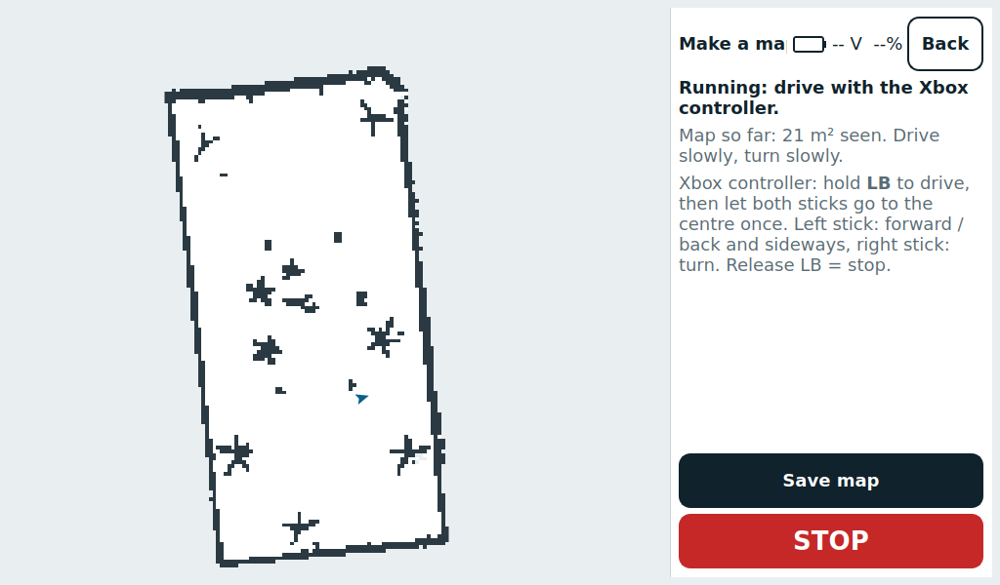 |

Both apps start as soon as you open them. Driving is only with the Xbox controller:

- Hold **LB**, then let both sticks go to the centre once.
- Left stick: forward, back and sideways. Right stick: turn.
- Release **LB** to stop.

**STOP** stops the app at once, **Start** starts it again, and **Back** stops it and returns to the map list. If
another app still runs, the screen says *Another app is running (...). Stop it first.*

### Saving a new map

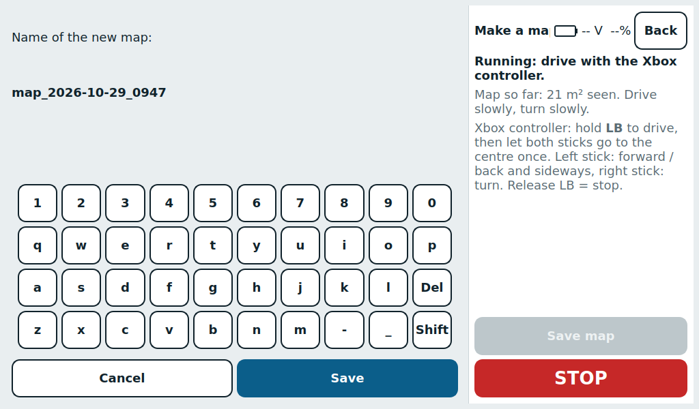

In app 2 the live map grows as you drive. Drive slowly and turn slowly. When the map looks complete, tap **Save
map**, type a name (the suggestion is `map_YYYY-MM-DD_HHMM`) and tap **Save**. Use letters, digits, `-` and `_` only,
and a name that is not taken yet. The map then appears in the map list, ready for planning.

## Settings

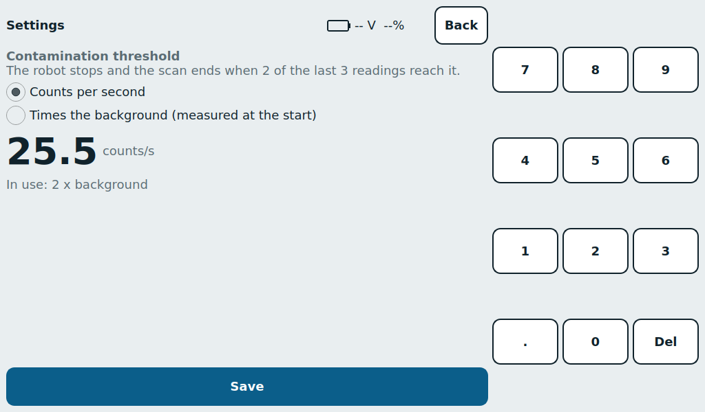

One contamination threshold for every map. Choose a mode and type the value on the keypad:

- **Counts per second**: a fixed count rate, above 0.
- **Times the background**: a factor times the background measured on the base station at the start of each scan,
  above 1.

Tap **Save**. The line under the value shows the setting in use. It is stored in `maps/contamination_threshold.yaml`.

## Map colours and symbols

| Colour / symbol | Meaning |
|---|---|
| white | Free floor |
| dark grey | Walls and obstacles from the map |
| light grey | Unknown: never seen while mapping |
| dashed robot outline + arrow | Base station and the direction the robot faces there |
| magenta dot | Start point (New plan tab) |
| green outline with dots | Area and its corners |
| blue arrow and line | The robot and the trail it really drove |
| teal | Scanned floor (the sensor covered it) |
| pale yellow to amber | Radiation readings, low to high |
| magenta | Readings at or above the threshold |
| numbered magenta diamond | Hotspot (white once checked) |
| red rings | Where a contamination stop happened |
| orange | New object: free on the map, but the LiDAR sees something |
| light blue | Removed object: on the map, but the LiDAR sees through it |

## Messages and what to do

| Message | Meaning / what to do |
|---|---|
| *Finding the robot on the map* | Wait. If it takes long, check that the robot is on the right map and the LiDAR spins. |
| *Robot is not on the base station...* / *the wrong way round* / *turned...* | Move the robot onto the dashed outline, facing the arrow. |
| *Checking the plan* | Wait: up to about 20 s the first time for a plan. |
| *Recalculating...* | The robot lost its position and is finding it again. It continues by itself within about 60 s. |
| *Paused: ...* (side panel) | Read the reason. Clear the way or move the robot by hand if needed, then **Resume**. |
| *Scan stopped, back home* | You used Go home and the robot is back on the base station. |
| *Contamination found: scan ended* | See [Contamination found](#contamination-found). |
| *App 3 stopped. Tap Back.* | The programs behind the scan ended (or crashed). Tap **Back** and start the scan again. |
| *The start point is closer than ... to a wall* | The robot cannot turn there. Tap a point further from walls. |
| *Area: Self-intersecting region* | Two edges of the area cross. **Clear area** and tap the corners in order around the area. |

## Troubleshooting

### Start stays grey

Start needs all of: *Localized* on, the robot on the base station, *Checking the plan* finished, and no task
running. The status line says which one is missing.

### A plan copied from the PC does not show up

Go back to the map list, tap **Refresh**, and open the map again. If the plan is grey, read its *Cannot scan*
reason. Copy the base station too (`base_station.yaml` next to `map.yaml`).

### The screen is frozen or the panel is gone

Restart the panel over SSH from the PC (only when no scan is driving; a reboot of the Pi also restarts it):

```bash
ssh nala@nala.local
pkill -KILL -f lib/nala_panel/panel
setsid nohup bash ~/NALA/scripts/start_panel.sh > ~/NALA/log/panel_restart.log 2>&1 < /dev/null &
```

The panel ignores the normal stop signals, so the first command force-closes it.
